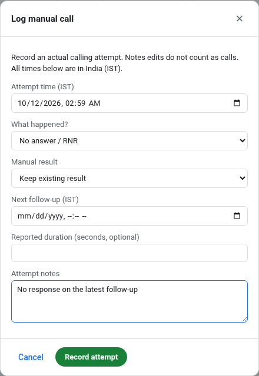
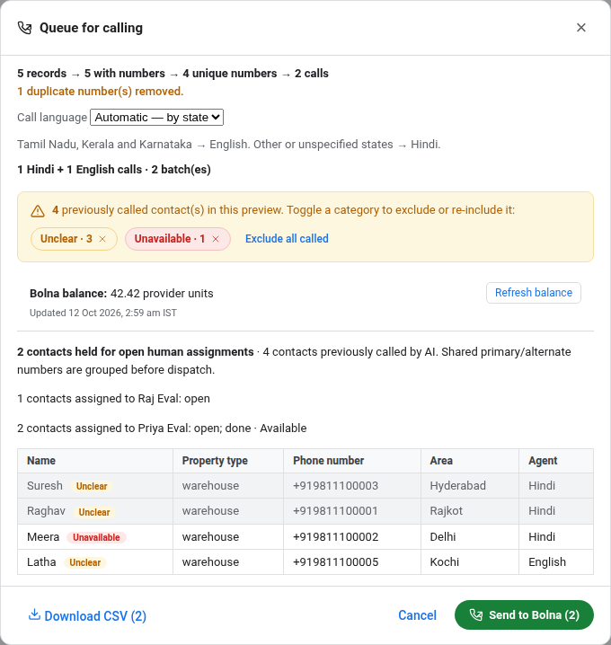
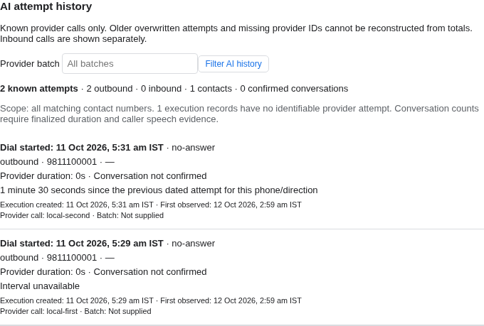
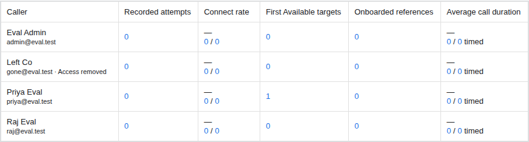

# Bolna DB Fixes — changelog

Unreleased · 12 October 2026 · 22-item handoff, three reviews and two completeness audits

## Release overview

Calling ownership, manual follow-ups, AI history and Team reporting implement the handoff's agreed rules. This release includes the review and audit corrections below and awaits deployment.

- **Completion stays valid:** editing Done work rechecks its result, warehouse reference and explanation. Available always needs an integer WH ID, including Exhausted closures.
- **Legacy edits stay possible:** an already-Done row does not need an invented call. Invalid completion data must be repaired, or the row reopened, before saving relevant edits.
- **Consistent times:** timestamps are stored as UTC and displayed in IST. Timezone-less provider values are interpreted as UTC; explicit offsets are respected.
- **Recovery resumes:** reconciliation commits its cursor with each page and yields after 1,000 executions. An interrupted run resumes the same snapshot.
- **Simpler rollout:** fourteen unshipped migrations are consolidated into three stages. Online indexes can wait beyond two seconds, subject to the overall statement timeout.

Corrections preserve an existing manual result, batch cards recognize every final provider status, completed-contact filters include shared numbers, and Team supports only the five requested measures.

Validation used local fixtures; no production migration or live calling was performed. See the [deployment runbook](docs/DEPLOYMENT.md) and [verification audit](docs/HANDOFF_COMPLETENESS_AUDIT.md).

## Caller workflow and completion

**Becoming Done requires a logged call.** RNR, busy, switched off, callbacks and awaiting confirmation remain open unless an assigned caller deliberately chooses **Exhausted** and provides a substantive reason. There is no additional attempt threshold or automatic cap.

**Done edits retain the same result-quality rules.** Available requires a positive integer WH ID; Unclear requires a closure reason and substantive explanation. Clearing those fields is rejected. This applies through both the API and database, including Exhausted work. Warehouse existence is not checked externally.

Legacy Done rows skip only the logged-call requirement. An invalid historical reference must be corrected before saving relevant changes. Reopening permits corrections before completing again.

**Keep existing result** preserves a dropdown choice and survives corrections to its supplying attempt. An explicit correction to the latest call replaces a result inherited from an earlier attempt; independent dropdown choices stay intact. Notes edits do not count as calls; corrected events replace superseded events in reports.

## Ownership and assignment

Primary and alternate numbers are deduplicated together. Bolna push and Queue CSV exclude contacts with open human ownership and use the same eligibility rules. CSV downloads recheck eligibility; dispatch rechecks phones, owners and reservations before reserving calls.

Unassigned excludes contacts with open or completed assignments. Dropped-only contacts qualify. Never assigned and Completed history also match shared numbers across Raw and Calls, including caller filters.

Assignment previews take no allocation lock, so caller saves continue while an admin previews. Round-robin carries forward across batches and retains work already held by selected callers. Manual batch allocation labels are readable.

## AI history and provider recovery

Provider timestamps without a timezone are treated as UTC consistently with the Calls grid; all displayed times use IST. This is the chosen application convention, **not an independently verified provider guarantee**. Confirm it against a known call before production acceptance. Explicit offsets keep their actual instant.

Intervals compare dated attempts for the same phone and direction. They display readable units such as “1 minute 30 seconds” or “7 days.” Missing or invalid times remain unknown.

One merged row represents each identifiable dial. Sparse updates preserve known fields, nested retry metadata and inbound contact identity; separate dials stay separate. Confirmed conversations require completed status, positive conversation duration and caller speech, excluding voicemail. Missing IDs and overwritten retries cannot be reconstructed. Balance-low is excluded from Raw history and default Calls views.

Webhooks and reconciliation accept optional duration/retry number, string and null variants. Reconciliation commits **250 executions and its cursor together**, processing at most **1,000 per invocation**. Reordered snapshots resume; changed snapshots restart idempotently. Leases recover after process exits and large batches yield to other cron work. Reservations remain until all pages and completion checks succeed.

## Reporting and everyday use

Team supports exactly the five requested measures, with IST date ranges, evidence on demand and matching CSV exports. The other nine metric branches and their URL selectors have been removed. Completion quality and follow-ups remain available in Assignments.

Unlogged historical calls are unknown. Average duration uses optional self-reported seconds and shows coverage. Correcting a mistaken Available attempt removes its Team credit; independent dropdown discoveries remain. First Available and onboarding dates are not invented by later edits. Retained historical warehouse references remain visible.

Calls' Added and WH ID edits save to the assignment used by filters and reporting. Safe legacy call-row verification is copied only to its exact existing assignment; unmatched or conflicting original values remain visible and exportable.

Other changes include multi-select filters, size ranges, onboarding filters, Calls rent-mentioned filtering, column controls, page jump, source city and Needs review help. Legacy Called By is labelled, hidden by default and read-only. City matching covers 13 documented alias pairs and city/urban/district suffixes. Fuzzy Calls search uses identifying fields; exact transcript and note search remains available.

Wallet balance uses a 60-second process cache with bounded timeout and visible errors. AI batch “No final result” cards now use the canonical final-status list, including call-disconnected.

## Migration and deployment

| Stage | Behavior |
| --- | --- |
| 006 — schema | Final ownership, manual lifecycle, per-dial history, completion rules and reconciliation cursor. Preserves safe legacy onboarding. |
| 007 — recovery | Resumable retained-payload backfill in 250-row transactions. Schema is already committed and recorded; a retry resumes recovery. |
| 008 — indexes | Concurrent search indexes outside a transaction. Lock timeout is disabled; the whole statement is limited to ten minutes by default. Invalid partial indexes are removed on retry. |

Baseline and migrations 001–005 are unchanged. The retired, unshipped 006–019 sequence is replaced; obsolete claims, wallet cache and delivery-ledger tables are never created. Existing development databases with that retired history are explicitly refused and must be rebuilt or upgraded deliberately. Do not delete migration ledger rows to bypass this check.

1. Verify a restorable backup and rehearse the pending sequence on representative staging data.
2. Pause writes and workers, drain old requests and preserve incoming webhook replay.
3. Run `npm run db:migrate` with the intended connection supplied explicitly.
4. Deploy the app, resume ingestion and perform the runbook's smoke checks.

**Compatibility:** Next.js 15 → 16.4.0, React 19 and Webpack flags are included. Verify the Node runtime and hosting adapter. Old call-row manual writes are retired. There are **no down migrations**; completed stages remain committed after a later failure.

The [deployment runbook](docs/DEPLOYMENT.md) covers recovery and acceptance. Production migration and restore performance have not been certified by the local synthetic tests.

## Verification and limits

**Verification: passed.**

| Check | Result |
| --- | --- |
| TypeScript and unit tests | Passed · 112/112 |
| Database/API integration | Passed · 239/239 |
| Migration rehearsals | Passed · 5/5 |
| Production build | Passed |
| Complete production browser run | Passed · 213; two volume cases run separately |
| Synthetic benchmark workloads | Passed · 19 workloads in one test |
| Separate volume browser | Passed · 2/2 |

Regression coverage includes API/direct-SQL completion rules, Exhausted/WH validation, correction provenance and Team credit, sparse inbound/retry metadata, final-status cards, UTC/IST parsing, shared-contact ownership, and reconciliation recovery/fairness.

Migration rehearsals cover fresh, legacy, through-005, interrupted recovery, and online indexes. The index rehearsal injects a statement timeout, retries the invalid index, holds a writer beyond two seconds, then verifies successful completion.

Automated checks use disposable local databases, synthetic contacts and fake provider credentials. Earlier read-only audits printed aggregate counts only: 61 warehouse references among 1,700 assignments, zero non-integer IDs; no WH references among 15,328 call rows. No new production audit was needed for this review.

Remaining acceptance: representative staging migration/restore, confirming provider time against a known call, real retry-chain/agent checks, and production traffic measurements. External warehouse existence, overwritten call history and the v2 analytics dashboard remain outside this delivery.

## Ticket coverage

| Item | Delivered behavior |
| --- | --- |
| H01 | Shared-phone deduplication in assignment, Bolna push and eligible CSV |
| H02 | Raw manual call history |
| H03 | Ownership, completed-contact history and AI preview context |
| H04 | Multiple categorical filter selections |
| H05 | Source city; larger dashboard explicitly deferred to v2 |
| H06 | Known attempts, IST dial times and readable intervals |
| H07 | Bounded reads, matching indexes and synthetic-volume checks |
| H08 | Wallet balance, cache, timeout and visible failure states |
| H09 | Separate AI and manual results |
| H10 | Manual/AI batches, corrected cards, filters and exports |
| H11 | Column visibility, narrower defaults and five-measure Team view |
| H12 | Jump-to-page controls |
| H13 | Balance blocks excluded from default calling activity |
| H14 | Legacy Called By labelled, hidden and read-only |
| H15 | Size, onboarding, city-alias and rent-mentioned filters |
| H16 | Needs review explanation and filter |
| H17 | Logged completion; retries stay open unless deliberately Exhausted |
| H18 | Integer WH ID and Unclear explanation validated on Done edits too |
| H19 | Completed history and ownership-checked reopening |
| H20 | Workloads and continuing round-robin assignment |
| H21 | IST dates, five measures and evidence/CSV on demand |
| H22 | Unassigned excludes open/completed contacts across shared phones |

The [implementation checklist](BOLNA_DB_FIXES_PLAN.md) retains the external acceptance items. This Markdown is the authored changelog; the PDF is generated from it with the selected browser screenshots.
