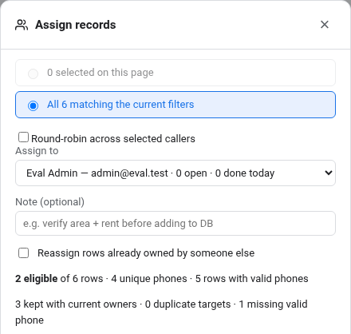
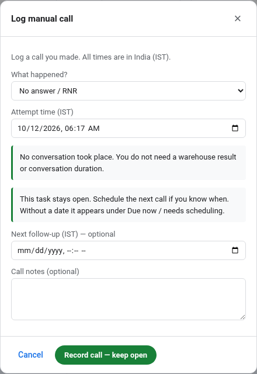
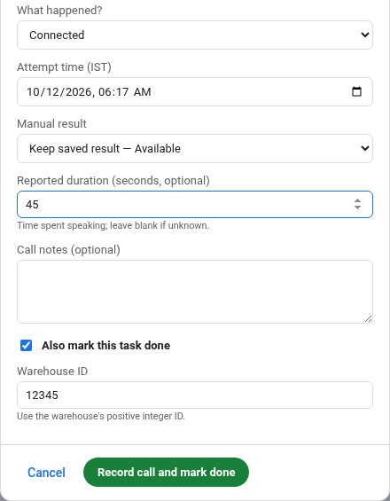
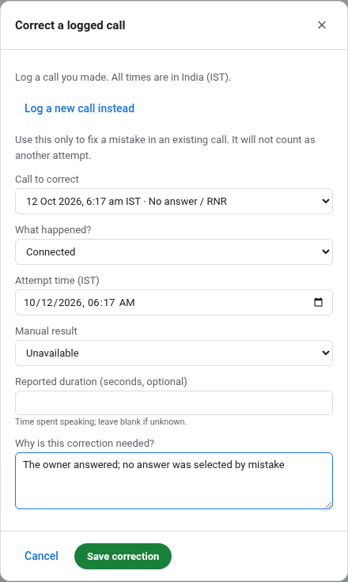
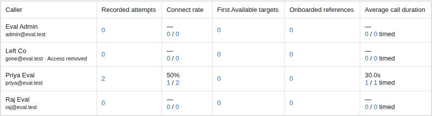

# Bolna calling dashboard — operational changelog

Review edition · 12 October 2026 · For callers and team managers

## A clearer daily calling workflow

This update helps the team assign contacts, record calls, organise follow-ups and review progress with fewer conflicting signals.

**Please review the workflows in this guide.** Focus on whether the screens match how your team works, the labels are understandable, and the counts match the work you record. The last page gives a practical review checklist.

### What changes for the team

- **Clearer ownership:** see who already has a contact before assigning work or preparing AI calls. Shared phone numbers are checked together.
- **A call form that fits the call:** unanswered calls need fewer fields; callbacks ask when to try again; connected calls can be recorded and completed together.
- **Clearer completion:** Available work needs a warehouse ID. Unclear work needs an explanation. An unanswered call stays open until it is followed up or deliberately closed as Exhausted.
- **Better context:** manual results, AI results and call history are shown separately. Call times display in IST.
- **Simpler daily reporting:** Team shows five measures, with links to the records behind the counts.

### About this review copy

**This is a feature review guide for the updated dashboard.** Use the checklist once the latest calling screens are available in your workspace. It covers daily operation; technical deployment and test records are kept separately.

All screenshots use fictional example contacts in a test workspace. This guide contains no customer records, credentials or internal troubleshooting logs.

## Assign work with ownership in view

From **Raw Dataset** or **Calls**, select records and choose **Assign**. The dialog distinguishes the selected rows on the current page from every row matching your filters.

Choose one caller, or use **Round-robin across selected callers** to distribute new tasks. Existing work held by those callers stays with them. The preview shows open workloads, planned assignments, shared-number duplicates and missing phones before you confirm.

**Unassigned excludes completed work as well as open assignments.** A contact completed through another listing with the same phone is still excluded. Contacts whose assignments were only dropped can become eligible again. Use **Completed history** to find finished work, or **Never assigned** for contacts with no assignment history.

**Review:** Select a small group, inspect its owners and planned actions, and confirm that existing work stays with the right caller.

## Prepare AI calls with fewer overlaps

**Queue for calling** checks primary and alternate phone numbers together. Duplicate calling contacts are grouped, and contacts with open human assignments are held out of the AI queue.

Review previous AI results and exclude categories you do not want to call again. The dialog also shows the available balance and language routing. Balance failures are visible; an unavailable balance is not shown as zero.

**Download CSV** applies the same ownership and calling eligibility checks as the queue. It checks again when you download, because ownership may have changed since the preview opened.

Sending to Bolna has a separate confirmation that starts live calling. After sending, use **Batches** to review the result and any contacts held back.

**Review:** Check that a contact already held by a caller is excluded from both the calling selection and the downloaded CSV.

## Log what actually happened

Choose **Log manual call**, then **What happened?** The form changes to fit your answer.

| What happened | What the form asks for |
| --- | --- |
| Connected | Manual result, optional conversation duration and notes. You can also complete the task here. |
| No answer / RNR, Busy, or Switched off / unreachable | Optional notes and an optional next-call time. No new warehouse result or conversation duration is requested. |
| Call back later / Will check and get back | A required follow-up time, with result, duration and notes available if relevant. |
| Verified invalid number | Notes and, if completing, how you verified that the number is invalid. |

An unanswered call keeps the task open and preserves any earlier warehouse result. Without a follow-up date, it appears under **Due now / needs scheduling**. Dates and times are entered in **IST**.

**Review:** Switch between Connected and RNR. Confirm that irrelevant fields disappear and that the save button explains whether the task will stay open.

## Complete Available work without the guesswork

**Available describes the warehouse. Connected describes the call. Done closes the task.** Changing Available or WH ID alone does not record a conversation.

If the last logged call was RNR and you later confirm availability, choose **Mark done**. The guided form shows the last call and the saved result. Record the later conversation, check **Also mark this task done**, and confirm the **Warehouse ID**. The call and completion save together.

If RNR was entered by mistake, choose **Correct an earlier call** instead. You do not need to invent an extra call to repair the entry.

Available completion requires a **positive integer WH ID**, such as 12345. It checks the format, not whether that ID exists in your warehouse system. Tick **Warehouse has been added to the database** if onboarding is complete. This updates the grid’s **Added** checkbox and onboarding reports; entering a WH ID alone does not tick it.

**Review:** Try RNR → Available → WH ID → Mark done. The screen should explain the missing call record and offer a clear way to finish.

## Follow up, correct mistakes and reopen

**Corrections:** Use **Correct an earlier call**, choose the call, correct its details and explain the mistake. The original stays in history; the correction does not count as an additional attempt. “Keep recorded result” preserves that call's result. An independent result saved on the task is retained.

**Unclear completion:** Choose a closure reason and explain why no further caller action is needed. “Call back later” is still pending work, not a completion explanation.

**Exhausted follow-ups:** An assigned caller may deliberately stop further attempts after a recorded retry call, with a meaningful reason in the task notes. There is no automatic attempt cap or additional minimum. Available work still requires its WH ID.

**Completed work:** Click **Done** to reopen a task. Existing Done rows can be edited without inventing past calls, but changes to the result, warehouse ID or completion explanation must remain valid.

Closing an edited call form asks before discarding its unsaved input. A failed save keeps the input available so it can be corrected and retried.

**Review:** Correct a mistaken RNR, complete the task, then reopen it. Check that the history remains understandable throughout.

## Find the right records and read their history

Use multiple selections within categorical filters, plus city, warehouse size and onboarding filters. **Calls** also supports rent-mentioned filtering. Common city aliases such as Bangalore / Bengaluru match together; distinct cities such as Mumbai / Navi Mumbai stay separate.

**AI result and Manual result are separate.** Needs AI review identifies an inference to check against its transcript or recording. Legacy Called By is read-only and hidden by default; manual call history identifies the person who recorded the work.

Expand **Show AI attempts** to see known dial times and gaps in minutes, hours or days. Inbound and outbound calls are counted separately. Balance-blocked activity is excluded from ordinary calling views; Calls has an option to include it for investigation.

Choose visible columns, save useful views and jump directly to a page. Source city remains available alongside AI-derived details.

**Review:** Find a contact using filters, compare AI and manual results, then open its call history. Known timestamps display in IST; older calls with missing history remain unknown.

## Review progress using five Team measures

Choose **Today**, **Yesterday**, **Last 7 days**, **This month**, or your own date range. Dates include full calendar days in India.

| Measure | What it tells you |
| --- | --- |
| Recorded attempts | Manual calls logged by the caller, after corrections. Editing notes does not add a call. |
| Connect rate | The share of logged calls marked Connected, Call back later, or Will check and get back. |
| First Available targets | Targets first recorded as Available by that caller. Reopening does not create another discovery. |
| Onboarded references | Staff-recorded onboarding with a warehouse reference. Reused references are not counted repeatedly across callers. |
| Average call duration | The average of reported conversation durations. The timed / connected count shows how much of the work has a duration. |

Click a count to inspect its supporting records and export them. Zero recorded calls does **not** prove that no calls happened: older unlogged manual activity cannot be reconstructed. Duration is optional and reported by the caller.

**Batches** separately tracks AI calling batches and manual assignment groups. Click a batch card to inspect and export the matching records. Original assignment membership and current ownership are shown separately.

**Review:** Log a connected call with a duration, then an unanswered call. Check the attempts, connection rate, duration coverage and linked records.

## Please review these everyday tasks

Use a few contacts approved for testing and review this list after the latest calling-screen update is available.

1. **Assign work:** Check the selected scope, existing owners, duplicate contacts and each caller's new workload.
2. **Prepare AI calls:** Confirm human-owned contacts are held out of the preview and CSV. Previewing or downloading does not start calls.
3. **Record RNR:** Check that only relevant fields appear, the task stays open and follow-up filtering finds it.
4. **Complete Available work:** Record the connected call, enter an integer WH ID and finish. Confirm whether Added should also be ticked for the warehouse.
5. **Handle exceptions:** Schedule a callback, close justified Exhausted work, and explain an Unclear completion.
6. **Repair a mistake:** Correct an earlier call, check that it counts once, and reopen completed work if another call is needed.
7. **Check the report:** Compare a caller's logged work with the five Team measures and the exported supporting rows.
8. **Check timing and readability:** Confirm one known call's IST time, try the screens on a phone, and flag any label that needs explanation.

### Send feedback in this format

**Screen → what you tried → what you expected → what happened.** Include a screenshot with sensitive contact details hidden where useful.

### What this update does not establish

It does not verify warehouse IDs against an external warehouse system, reconstruct overwritten or unlogged call history, or deliver the larger v2 analytics dashboard. Provider timestamps without an explicit timezone are treated as UTC before display in IST; confirm a known call's time during acceptance.
