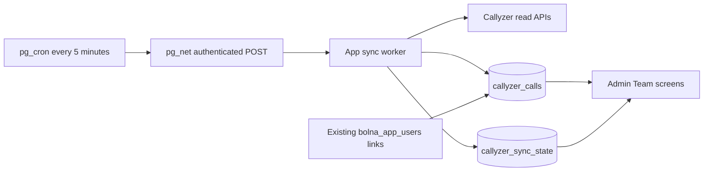

# Callyzer caller activity

Team → Access control links a dashboard caller to one Callyzer number and an
attribution start date (IST). Linking requires an existing dashboard user and cannot
grant sign-in access. Callers without a link show **Manual only**. Linking
claims previously unassigned imported calls from that date. Existing attributed
history stays with its original caller when a number changes or is unlinked;
changing a link is not a historical reassignment operation. Access removal also
retains history. The importer includes account employees without dashboard links,
so those calls can be attributed when a link is added later.

Team → Performance shows employee callers only; admin accounts remain in Access
control. One caller overview places Callyzer calls, connections and talk time next
to recorded Available/onboarded outcomes, with each source labeled. Callers without
received calls, recorded outcomes or a current link can be revealed with Show more.
Manual call logs and per-caller device details are collapsed. Outcome audit tables
and their drill-down links are removed from Performance; existing evidence exports
remain available through the admin API and use the same employee-only roster.
The shared date/caller/access filters also contain the call-channel selector.
Select a call count for paginated history; filter Phone, WhatsApp voice or WhatsApp video. A
connected call is Incoming/Outgoing with duration >2 seconds. Talk time sums these
calls. Missing durations are reported and excluded. Imported activity does not
create manual attempts, change outcomes, or award onboarding.
Live history includes both `HH:mm` and `HH:mm:ss` call times. Minute-precision
values are stored at `:00` seconds; invalid dates and times still fail validation.

The shared **Manual activity → Call history** drawer in Assignments, Raw Dataset,
AI Calls, My Work and manual batches interleaves imported calls with staff logs.
History links are available even without staff logs. Assignment cards count both
imported and manually entered records using the same matching query as their
timeline, batched for the visible page. The drawer lists only sources with entries.
Imported calls match all full
phone numbers on a listing, or the customer number on an execution (the sender for
inbound calls). Local numbers use the dashboard's India convention; international
country codes are kept, so equal last-ten digits alone do not establish a match.
This is contact context, not property attribution: shared-phone listings can show
the same imported call. The match is evaluated on demand from the existing tables.

The two sources share chronological pagination but retain source labels and
separate totals. Staff corrections stay visible and only staff logs are editable.
No heuristic merges a staff log with a provider call; the total is history entries,
not distinct calls. Employees see only their own imported calls on records they can
currently access; admins see matching calls for the configured Callyzer account.
Unassigned or dropped records do not grant employees access through a phone match.

## Small architecture

Only two new tables, plus three nullable columns on `bolna_app_users`. Call IDs are
opaque strings, keyed with a stable account namespace. Attribution is saved with
each imported call. Both new tables have RLS enabled and no browser-role grants.
Only admins can manage links or read team-wide automatic reports. Contact timelines
also expose scoped imports to their assigned employee. The worker uses the
existing `PROCESS_SECRET`; its Callyzer token remains server-side.

One account lease prevents competing workers. A persisted cooldown uses PostgreSQL's
clock to wait 2.2 seconds after each response, including failures. Database latency
and differences between app clocks cannot shorten the interval between requests.
The exclusive lease makes advance rate-slot reservations unnecessary. The lease
is checked again after waiting and before HTTP starts. Each page and its checkpoint commit together;
expired or superseded leases cannot write pages. The worker has a 35-second work
budget, a 12-second HTTP deadline and a 60-second route limit. It yields and resumes
pages on subsequent runs. Failures retain committed progress and schedule exponential
backoff, honoring Retry-After up to 24 hours. A cron HTTP success alone is not proof
that ingestion is current; consult the stored watermarks and completed-import time.

Initial history uses call time, starting at IST midnight 30 days ago (configurable
1–179 days on the first run). Subsequent polling uses sync time with a one-hour
overlap, so late uploads can import older calls. All three channel windows are
prepared with a fixed target, so a resumed cycle can finish even with slow API
responses. A persisted sequence gives each unfinished channel a turn across
invocations without relying on app clocks. Import bounds and device-check timestamps
use PostgreSQL time, just like leases and cooldowns. Local work budgets use monotonic
elapsed time. All three streams must cover that cycle's target before the completed-import
time advances; an older completed cycle can still need catch-up.
Pagination requires the documented page number, page size and total. The returned
page size is pinned for the remaining pages. Missing/contradictory metadata, changed
page sizes and repeated pages hold the checkpoint and retry instead of claiming
complete coverage. IDs deduplicate overlap; older provider versions cannot overwrite
newer stored versions.

Employee metadata is refreshed after call ingestion when budget remains, one linked
employee per invocation and at most hourly per employee. A lookup failure records
unknown device status without blocking call ingestion; authorization failures and
429s still apply account backoff. HTTP 400 does not prove a number is absent.
Employee lookup requires **GET /employee/get with a JSON body**;
history uses **POST /call-log/history**. The Node HTTPS client supports this GET
body, has no automatic redirects, and does not log response bodies or tokens.
The live employee API also returns display dates (`27 Oct 2026, 05:14 PM`) and
Yes/No strings for settings. These are normalized explicitly in India time;
unknown settings remain unknown. Device warnings remain visible alongside a
delayed-import warning.

## Coverage and limitations

- **Manual only:** no current Callyzer link. Previously attributed received calls
  remain visible in counts and history; absent activity shows a dash.
- **Import pending / Sync not configured:** no finished initial import or missing
  server credentials. Any received counts are provisional.
- **Partial coverage:** the requested dates extend beyond the initial import or
  caller's attribution date, include future dates, or not all streams cover the period.
- **Future period:** the selection has not started; automatic counts show a dash.
- **Link not checked / Number not found:** the link is unverified or a successful
  employee lookup did not find it. Missing received activity is not displayed as zero.
- **App uninstalled / Device logging off:** Callyzer explicitly reports a condition
  that can prevent new uploads. Previously received calls remain visible.
- **Sync delayed:** a request failed or no complete import finished for 15 minutes.
- **Imported:** the selected period lies within the linked/imported range. This
  describes API ingestion, not complete device coverage.

The UI shows the conservative minimum watermark across selected streams. A device's
`last_sync_req_at` is only a sync-request timestamp; it does not prove that all calls
uploaded. Unmatched numbers, stale metadata, unknown update times and missing
durations stay visible. Zero received calls does not establish employee inactivity.
All time includes retained data and is labeled partial. The default account timezone
is fixed to Asia/Kolkata; explicit IST/UTC/ISO offsets in provider timestamps are
honored. Configure a different timezone parser before using a non-India account.

Callyzer does not document stable snapshot pagination, retention, exact boundary
inclusivity, or whether every edit reappears under sync-time filters. Overlap reduces
gaps but cannot guarantee exhaustive change capture or detect device-side losses.
Deletions are not propagated. Recovery must not claim historical completeness.
A persistently malformed call or pagination response holds its unfinished window;
the completed cycle does not advance until that source problem is resolved. This
deliberately avoids silently dropping records. Correcting a historically wrong
caller attribution currently requires a reviewed database correction; changing the
number link alone keeps already-attributed calls.

## Activation

1. Apply `npm run db:migrate` with an explicitly supplied DDL connection. Migration
   `013_callyzer.sql` must precede deployment of code that selects the new columns.
2. Deploy with `CALLYZER_API_TOKEN`, stable `CALLYZER_ACCOUNT_KEY` (default `primary`),
   and `PROCESS_SECRET`. Use one Callyzer account per app database. A different
   account key alone does not isolate the shared user links; sandbox must use a
   separate database and key from production.
   Keep one polling deployment per provider account; other API consumers must share
   its rate limit. No token is committed in this repository.
3. Supabase must have pg_cron, pg_net and Vault enabled. Vault secret `process_secret`
   must equal the deployed `PROCESS_SECRET`. The reviewed scheduler URL is
   `https://ai-calling-wareongo.vercel.app/api/callyzer/sync`; update it before using
   another deployment. Run `node database/schedule-callyzer.mjs` with explicit DB
   environment and `PROCESS_SECRET` to verify in a rollback transaction, then
   `node database/schedule-callyzer.mjs --apply` to install the job.
4. Link callers in Access control. Check that all three streams complete, the next
   run catches up, device lookups resolve, and coverage appears in Performance.

The scheduler is idempotent, refuses to replace an unrelated job with the same
name, and reads the worker secret from Vault at invocation time. It does not store
the Callyzer API token in PostgreSQL. Disable with `cron.unschedule('sync-callyzer')`;
retained call history and manual workflows remain available.

Validation uses fake provider responses and the disposable local Postgres database;
it never contacts the live provider or downloads recordings.
